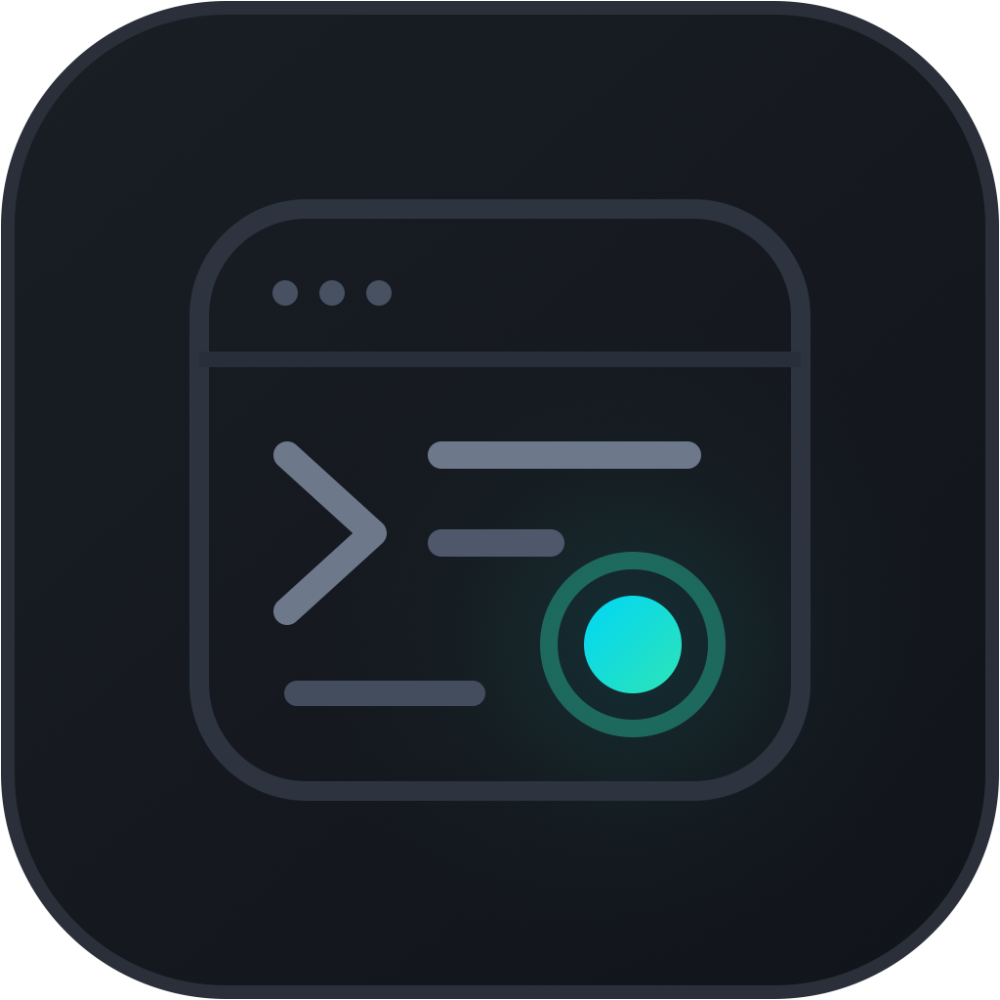

<p align="center">
  
</p>

<h1 align="center">og</h1>

<p align="center">
  A 120fps native macOS code editor built exclusively for Go.<br>
  Zero Electron, zero WebViews — instant startup, sub-millisecond typing, and a built-in native PTY terminal.
</p>

<p align="center">
  <a href="https://github.com/fuwasegu/og/releases/latest">Download</a> ·
  <a href="README.md">日本語</a>
</p>

<p align="center">
  
  
  
</p>

## Install

```sh
brew install --cask fuwasegu/tap/og
```

To upgrade:

```sh
brew upgrade --cask fuwasegu/tap/og
```

Requires **macOS 14 (Sonoma)+**. Or grab `og.app.zip` directly from [Releases](https://github.com/fuwasegu/og/releases/latest).

## Features

- **Zero WebViews, True 120fps Rendering** — Both the code editor and the integrated terminal render directly via AppKit (`NSView`) and `CoreText` on GPU-backed layers. Only visible rows intersecting the viewport are drawn, and syntax highlighting is cached per buffer version so scrolling and rapid typing stay locked at 120Hz.
- **GoLand-Style Postfix Completion (`Tab`)** — Append `.err`, `.var`, `.forr`, `.for`, `.nn`, `.nil`, `.return`, `.print`, `.not`, or `.len` to any Go expression and press `Tab` to expand it into idiomatic Go boilerplate (e.g., `err.err` → `if err != nil { return err }`, `NewServer().var` → `server := NewServer()`), with a live preview badge right beside your cursor.
- **One-Click Struct Tag Generator (`⌘⇧T` / `🏷 +json tags`)** — Click the inline `🏷 +json tags` badge on any `struct` declaration or choose from the **Struct Tags** toolbar menu (`json (snake_case)`, `json (camelCase)`, `json (omitempty)`, `json + yaml`, `db + json`) to automatically generate or update backtick struct tags.
- **Table-Driven Test Generator (`⌘⇧G` / `🧪 +Table Test`)** — Click `🧪 +Table Test` next to any function/method (or press `⌘⇧G`) to scaffold an idiomatic Go table-driven test (`tests := []struct{ ... }` + `t.Run`) and jump straight to it.
- **Bidirectional Interface ⇄ Struct Navigation (`⇄ implements` / `⇣ implemented by`)** — Live AST analysis annotates structs with the interfaces they satisfy (`⇄ implements Handler`) and interfaces with the structs that implement them (`⇣ implemented by Server`). Click any badge, press `⌘B` / `⌘Click`, or use the **Structure** menu to jump directly to declarations.
- **Zero-Config `gopls` with Auto-Healing** — Automatically spawns and supervises `gopls` over JSON-RPC 2.0 for live diagnostics, inline error underlines, and latency telemetry. If `gopls` ever crashes, `og` restarts it with exponential backoff and seamlessly restores your open buffer state.
- **Automatic `gofmt` on Save** — Pressing `⌘S` formats your Go file via `gofmt` while preserving your cursor position, alongside smart bracket/quote auto-pairing (`{}` / `()` / `[]` / `""`) and `⌘/` line comment toggling.
- **Transactional Symbol Rename with Diff Preview (`⌘⇧R`)** — Preview cross-file symbol renames as a Unified Diff before touching disk. Changes are committed atomically via temporary files and automatically roll back across all files if any write fails.
- **Inline Test, Benchmark & `main()` Runner** — Click `▶ Run Test`, `▶ Bench`, or `▶ Run main` directly in the editor to execute tests or `go run .` without leaving your code.
- **Built-in Native PTY Terminal (`⌘J`)** — Toggle a dockable terminal backed directly by Darwin `openpty` and `DispatchSourceRead` with 24-bit TrueColor and ANSI support — run `go run`, `git`, or CLI agents without leaving the editor.
- **100% Local AI Inline Completion (FIM)** — Connects to a local `llama-server` (`127.0.0.1:8080`) for Fill-in-the-Middle streaming ghost text.

## Keyboard Shortcuts

| Shortcut | Action |
|---|---|
| `Tab` | Expand GoLand Postfix Completion (`.err`, `.var`, `.forr`, `.nn`, etc.) / Accept AI Ghost Text |
| `⌘B` / `⌘Click` | Go to Declaration (struct, interface, func, method) |
| `⌘⇧T` | Generate `json` (`snake_case`) struct tags for current struct |
| `⌘⇧G` | Generate GoLand Table-Driven Test for current function |
| `⌘⇧R` | Transactional symbol rename (with Unified Diff preview) |
| `⌘D` | Duplicate current line or selection (GoLand style) |
| `⌥⇧↑` / `⌥⇧↓` | Move current line up / down |
| `⌘/` | Toggle line comment (`//`) |
| `⌘O` | Open `.go` file |
| `⌘S` | Save + auto-format with `gofmt` |
| `⌘J` | Toggle built-in native PTY terminal |
| `⌘C` / `⌘X` / `⌘V` | Copy / Cut / Paste (whole line when nothing is selected) |
| `⌘Z` / `⌘⇧Z` | Undo / Redo |
| Double / Triple-click | Select word (identifier) / Select full line |

## Requirements

- **macOS 14 (Sonoma)** or later
- **[Go](https://go.dev/)** and **[`gopls`](https://pkg.go.dev/golang.org/x/tools/gopls)**
  ```sh
  brew install go gopls
  ```
- *(Optional)* Local `llama-server` running on `http://127.0.0.1:8080` for local FIM inline completions.

## Development

```sh
# Build and launch from source
make run

# Package build/og.app bundle (with AppIcon.icns)
make app
```

<details>
<summary>Verification Harness & Releasing</summary>

```sh
# Install pre-commit / pre-push guardrails
make install-hooks

# Run all 4 verification gates (Static Guardrails, StrictConcurrency Debug, 300-step Fuzz + Latency SLAs, Release)
make check
```

Pushing a `v*` tag triggers GitHub Actions (`.github/workflows/release.yml`) to run the harness, package and sign `og.app`, publish a GitHub Release, and update `fuwasegu/homebrew-tap` automatically.

</details>
