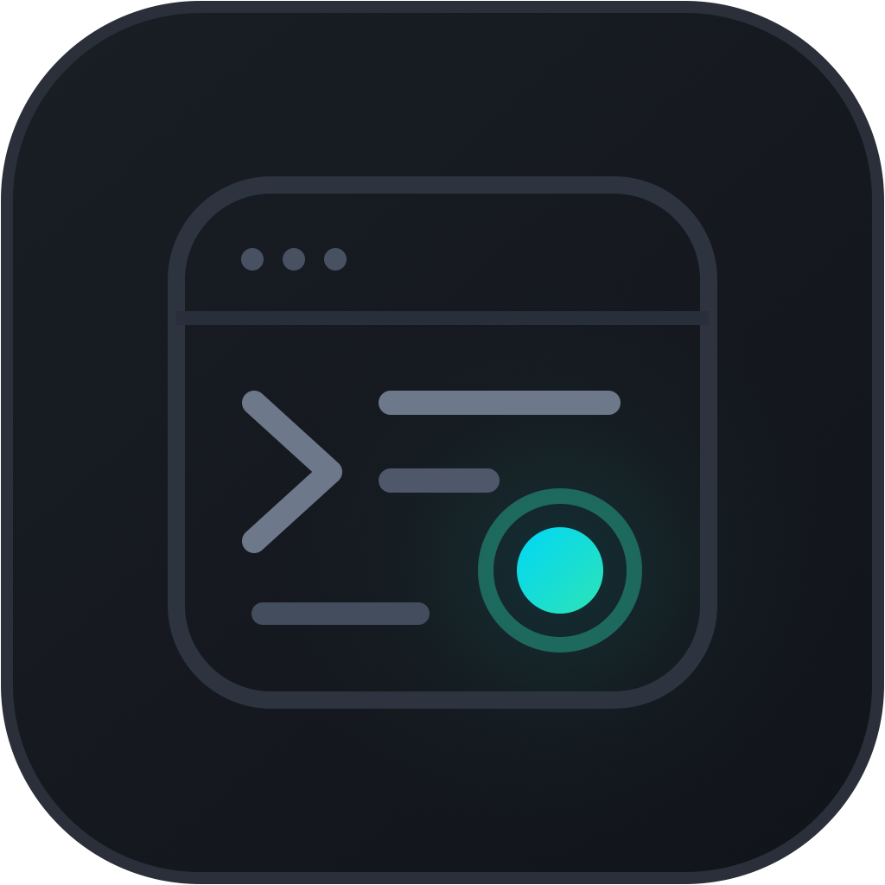

<p align="center">
  
</p>

<h1 align="center">og</h1>

<p align="center">
  Go を書くための、ネイティブ macOS IDE。<br>
  GoLand の操作感を、AppKit だけで軽く動かすことを目指しています。
</p>

<p align="center">
  <a href="https://github.com/fuwasegu/og/releases/latest">ダウンロード</a> ·
  <a href="README.en.md">English</a>
</p>

## インストール

```sh
brew install --cask fuwasegu/tap/og
```

要件は macOS 14 以降です。Go のツールは Homebrew で入れてください。

```sh
brew install go gopls delve
```

## できること

- プロジェクト：フォルダ（`go.mod` / `go.work`）を開く、ファイルツリー、タブ、前回のタブを復元
- 編集：Go の構文ハイライト、自動インデント、括弧の自動補完、行の複製・移動・コメント切り替え、選択範囲の拡張、日本語入力
- 保存：GoLand と同じ自動保存（フォーカスを外したとき、タブを切り替えたとき、入力が止まったとき）。`⌘S` で import 整理と gofmt をかけて保存
- 外部変更：未編集のファイルは自動で読み直します。編集中に外部で変わったら、どちらを残すか選べます
- gopls：補完、診断、ホバー、シグネチャ、定義・実装・型定義へ移動、使用箇所の検索、クイックフィックス、ファイル構造。gopls が落ちても自動で再起動します
- リファクタ：プレビュー付きのリネーム。全ファイルを一括で置き換え、途中で失敗したら元に戻します。一括の取り消しも可能です
- 実行とテスト：ガターの ▶ から `go run` / テスト / ベンチマークを実行し、結果はテストツリーで表示
- デバッガ：delve によるブレークポイント、ステップ実行、変数、式の評価
- Git：ツリーと差分ガターに状態を表示、commit、ブランチの切り替えと作成、stash
- 検索：ファイルへ移動、シンボルへ移動、最近のファイル、全文検索と一括置換
- ターミナル：複数タブの内蔵ターミナル（xterm 互換）
- Go 向けの機能：Postfix 補完（`.err` `.var` `.for` `.nn` など）、Struct タグの生成、Table-Driven Test の生成
- ローカル AI 補完：`llama-server` によるインライン補完。接続先はループバックアドレスだけで、コードは Mac の外へ出ません（設定でオン）

注意：デバッガを初めて使うと、macOS が「Developer Tools Access」の許可を求めます。毎回の入力を省くには、`sudo DevToolsSecurity -enable` を一度実行します。

## 主なショートカット

GoLand の macOS 用キーマップに合わせています。

| キー | 動作 |
|---|---|
| `⇧⌘O` / `⌥⌘O` / `⌘E` | ファイルへ移動 / シンボルへ移動 / 最近のファイル |
| `⌘B` / `⌥⌘B` / `⌥F7` | 定義へ移動 / 実装へ移動 / 使用箇所 |
| `⌥↩` / `F1` / `⌘P` | クイックフィックス / ドキュメント / パラメータ情報 |
| `⇧F6` | リネーム |
| `⌃R` / `⌃D` | 実行 / デバッグ（キャレット位置のテストまたは main） |
| `⌘F8` / `F8` / `F7` / `⇧F8` | ブレークポイント / ステップオーバー / イン / アウト |
| `⌘K` | Commit |
| `⇧⌘F` | 全文検索 |
| `⌥F12` | ターミナル |
| `⌘[` / `⌘]` | 戻る / 進む |
| `⇧⌘T` / `⇧⌥⌘G` | Struct タグを追加 / Table Test を生成 |

## 開発

仕様は `spec/` に FSL で書いてあり、`fslc` で検証します。詳しくは `spec/README.md` と `AGENTS.md` を見てください。

```sh
make check   # ガードレール、ビルド、テスト、リリースビルド
```

```sh
make spec    # FSL 仕様の検証
```

```sh
make app     # build/og.app を作る
```

`VERSION` を更新して `v*` タグを push すると、GitHub Actions がビルド、署名、Release の公開、Homebrew Cask の更新まで行います。
